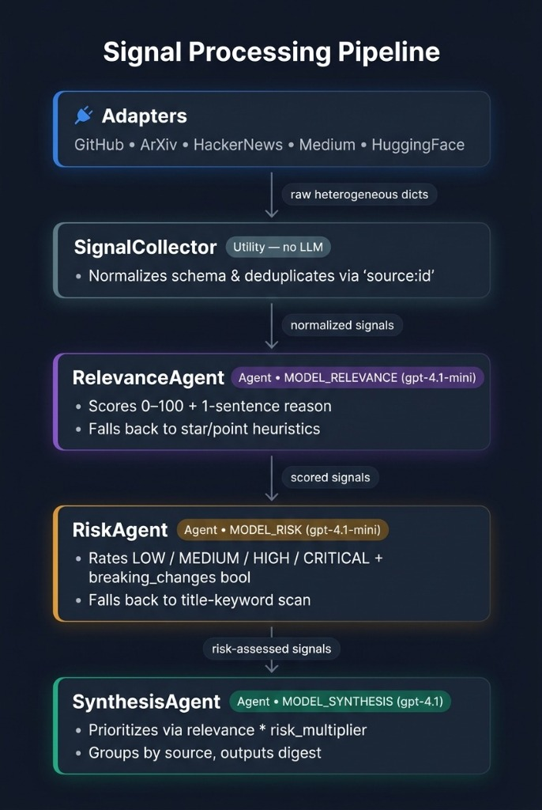

# 🧠 DevPulseAI — Client-Tailored & Cost-Governed Signal Intelligence

An enhanced multi-agent signal intelligence pipeline built on [`devpulse_ai`](https://github.com/Shubhamsaboo/awesome-llm-apps/tree/main/advanced_ai_agents/multi_agent_apps/devpulse_ai), upgraded for **domain-specific relevance**, **OpenRouter LLM routing**, and **deterministic cost governance**.

---

## 1. Project Overview & Baseline Architecture

`devpulse_ai` is a multi-agent signal intelligence pipeline that collects public technical updates from five developer sources (**GitHub**, **ArXiv**, **HackerNews**, **Medium**, and **HuggingFace**), scores them for relevance, assesses operational/security risks, and produces a prioritized intelligence digest.

Its defining architectural rule is:
> **Agents are used only where reasoning is required.** Deterministic operations (fetching, schema normalization, deduplication) are implemented as plain utilities — not agents.

### Baseline Pipeline



### Baseline File Map 

| File | Role | Baseline Behavior |
|---|---|---|
| `adapters/github.py` | Data fetcher | Queries GitHub Search API for repos created in the last 24h |
| `adapters/arxiv.py` | Data fetcher | Hardcoded to `cat:cs.AI OR cat:cs.LG` Atom XML |
| `adapters/hackernews.py` | Data fetcher | Hardcoded to Algolia query `"AI OR LLM OR Machine Learning OR GPT"` |
| `adapters/medium.py` | Data fetcher | Parses 4 hardcoded RSS feeds (AI, ML, Netflix Tech, Meta Eng) |
| `adapters/huggingface.py` | Data fetcher | Fetches top liked models from `huggingface.co/api/models` |
| `agents/signal_collector.py` | Deterministic utility | Deduplicates via `f"{source}:{id}"` and normalizes fields |
| `agents/relevance_agent.py` | LLM classifier | Hardcoded for `"AI/ML developers"`, uses `OpenAIChat` |
| `agents/risk_agent.py` | LLM analyzer | Evaluates vulnerabilities/breaking changes unconditionally on every signal |
| `agents/synthesis_agent.py` | Digest builder | Prioritizes via `relevance * risk_multiplier` and formats summary |
| `main.py` / `streamlit_app.py` | Runners | CLI pipeline & Streamlit dashboard |
| `verify.py` | Offline test suite | 5 mock-data verification checks (no API keys required) |

---

## 2. Why I Chose This Project to Upgrade

This codebase aligns directly with **AI Forward Deployed Engineering (FDE)** principles and production AI engineering best practices:

- **Honest Agent Boundaries:** It already separates deterministic work (`SignalCollector`) from reasoning work (`RelevanceAgent`, `RiskAgent`, `SynthesisAgent`) instead of wrapping simple loops in unnecessary LLM calls.
- **Enterprise-Relevant Use Case:** Technical teams across AI/ML, FinTech Compliance, Cloud Infrastructure, and DevSecOps all face signal overload and need tailored, risk-aware briefings rather than generic news feeds.
- **High-Leverage Upgrade Surface:** With targeted, minimal changes (~5–10% codebase scope), the pipeline can demonstrate **no vendor lock-in**, **client customization**, **deterministic LLM cost reduction**, and **graceful offline verification**.

---

## 3. Problems / Gaps Identified & Objective

### Baseline Gaps Found During Code Review

1. **Single-Provider Lock-In (`OpenAIChat` only):** All three agents instantiated `OpenAIChat(id=...)` targeting OpenAI directly, with no OpenRouter routing or `.env` loading in `streamlit_app.py` / `main.py`.
2. **Hardcoded AI/ML Persona & Queries:** `RelevanceAgent` scored every item for `"AI/ML developers"`, while `arxiv.py`, `hackernews.py`, and `medium.py` used hardcoded AI/ML queries—making non-AI domains inaccurate.
3. **Unconditional `RiskAgent` Calls (Wasted LLM Tokens):** `RiskAgent.assess_batch()` ran an LLM call on **every** collected signal, including low-relevance noise (`0–30`).
### Objective

Upgrade `devpulse_ai` into a **Client-Tailored & Cost-Governed Signal Intelligence** pipeline while keeping the implementation clean, simple, and 100% compatible with offline verification (`python verify.py`):
- Support **OpenRouter** (`google/gemini-2.5-flash-lite` by default) with `.env` loading and zero leaked secrets.
- Make **both source fetching and relevance/risk scoring dynamic** based on a user-selected **Target Domain** preset.
- Add a **deterministic cost gate** (with a critical security-keyword bypass) before `RiskAgent` so noisy signals never trigger unnecessary LLM calls.
- Keep the Streamlit UI fast and responsive on startup.

---

## 4. Enhancements Implemented

### 4.1 LLM-Agnostic Routing via OpenRouter & Secret Isolation
- **Mission:** Eliminate single-provider lock-in and keep credentials isolated from agent prompts.
- **Actions:**
  - Routed `RelevanceAgent`, `RiskAgent`, and `SynthesisAgent` through OpenRouter's OpenAI-compatible endpoint (`https://openrouter.ai/api/v1`) using `google/gemini-2.5-flash-lite` as the default low-cost model.
  - Added `load_dotenv()` at startup in `streamlit_app.py` and `main.py`, with `.env` excluded from git via `.gitignore`.

### 4.2 Domain Presets & Source-Aligned Collection (`config.py` + `adapters/`)
- **Mission:** Ensure fetched news and engineering signals match the user's chosen domain rather than only AI/ML.
- **Actions:**
  - Created `config.py` with `DomainProfile` and `DOMAIN_PRESETS` for 5 domains: **AI/ML Engineering**, **FinTech Compliance**, **Cloud Infrastructure**, **Cybersecurity & DevSecOps**, and **Data & Backend Engineering**.
  - Updated `adapters/github.py`, `adapters/arxiv.py`, `adapters/hackernews.py`, and `adapters/medium.py` to accept domain-specific queries and RSS feeds while preserving backward-compatible defaults.

### 4.3 Dynamic Domain Relevance & Fallback Telemetry (`agents/relevance_agent.py`)
- **Mission:** Score signals through the lens of the selected domain and track whether live LLM or heuristic fallback was used.
- **Actions:**
  - Injected the active domain's focus and tech stack into `RelevanceAgent` instructions and scoring prompts.
  - Updated `_fallback_score()` to match domain keywords against signal titles and descriptions, and added `"used_fallback"` tracking on every scored signal.

### 4.4 Client-Aware Risk Analysis & Deterministic Cost Gate (`agents/risk_agent.py` + `agents/synthesis_agent.py`)
- **Mission:** Cut unnecessary LLM calls on low-relevance noise without missing critical security alerts.
- **Actions:**
  - Contextualized `RiskAgent` prompts with the active domain's focus and tech stack, tracking `"used_fallback"` and `"gated"`.
  - Added a deterministic relevance gate before `RiskAgent`: signals below `min_relevance=50` skip the LLM call (`risk_level: "SKIPPED"`, `gated: True`) unless they contain a critical security keyword (`cve`, `vulnerability`, `exploit`, `breach`, `zero-day`, `rce`).
  - Updated `SynthesisAgent._prioritize_signals()` to rank `"SKIPPED"` items below `"LOW"` risk.

### 4.5 Responsive UI, Priority Ordering & CLI Support (`streamlit_app.py` + `main.py`)
- **Mission:** Deliver a fast, intuitive interface for switching domains and reviewing prioritized signals.
- **Actions:**
  - Added a preset-only **Target Domain** dropdown in `streamlit_app.py` and a `--domain` flag in `main.py`.
  - Sorted displayed signals by descending relevance score and added `.risk-skipped` badge styling.
  - Moved `st.set_page_config(...)` to the top of `streamlit_app.py`, lazy-loaded heavy `agents` imports on Run, and removed the missing `assets/logo.png` call so the UI renders immediately.

### 4.6 Expanded Offline Verification (`verify.py`)
- **Mission:** Guarantee all enhancements work deterministically offline in seconds without spending API credits.
- **Actions:**
  - Added check `[6/6]` in `verify.py` to validate all 5 domain presets, domain-specific fallback scoring, `"used_fallback"` flags, `"SKIPPED"` cost gating, and critical-keyword (`CVE`) bypass.

---

## How to Run

### 1. Offline Verification (No API Key Required)
```powershell
python verify.py
```

### 2. CLI Pipeline (With OpenRouter)
Create a `.env` file (ignored by git):
```env
OPENROUTER_API_KEY=sk-or-v1-...
MODEL_RELEVANCE=google/gemini-2.5-flash-lite
MODEL_RISK=google/gemini-2.5-flash-lite
MODEL_SYNTHESIS=google/gemini-2.5-flash-lite
```
Run with a specific domain preset:
```powershell
python main.py --domain "Cloud Infrastructure"
```

### 3. Streamlit Dashboard
```powershell
python -m streamlit run streamlit_app.py
```
Then open `http://localhost:8501`, select a **Target Domain** and **Signal Sources** in the sidebar, and click **🚀 Run Intelligence Pipeline**.
